# Fork effects showcase

[Back to the README](../README.md)

Every image below was captured from this fork running in an isolated Linux libobs/OpenGL session. The same Gemini-generated source footage is used throughout; the effect output is rendered by the actual OBS plugin, not generated or simulated separately. Click a still to open its three-second animated WebP.

## Original footage

[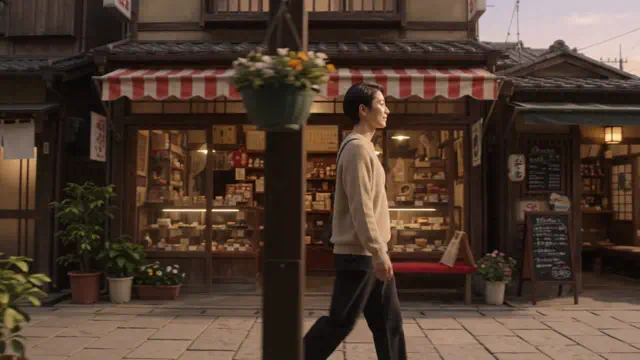](showcase/clean.webp)

[Play original preview](showcase/clean.webp)

## Dither

All twelve modes use the same settings (2 color steps per channel, logical pixel size 2 px, color mode). The stills link to the original-size animated previews; open them at 100% to inspect individual dither patterns.

<table>
<tr><th>None / Posterize</th><th>Bayer 2×2</th><th>Bayer 4×4</th></tr>
<tr><td><a href="showcase/posterize.webp">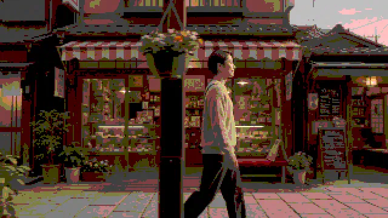</a> <a href="showcase/posterize.webp">Play preview</a></td><td><a href="showcase/bayer2.webp">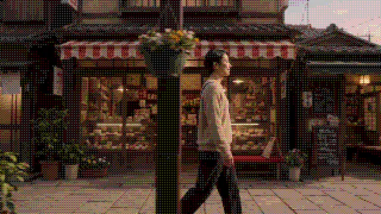</a> <a href="showcase/bayer2.webp">Play preview</a></td><td><a href="showcase/bayer4.webp">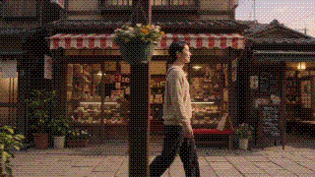</a> <a href="showcase/bayer4.webp">Play preview</a></td></tr>
<tr><th>Bayer 8×8</th><th>Directional horizontal</th><th>Directional vertical</th></tr>
<tr><td><a href="showcase/bayer8.webp">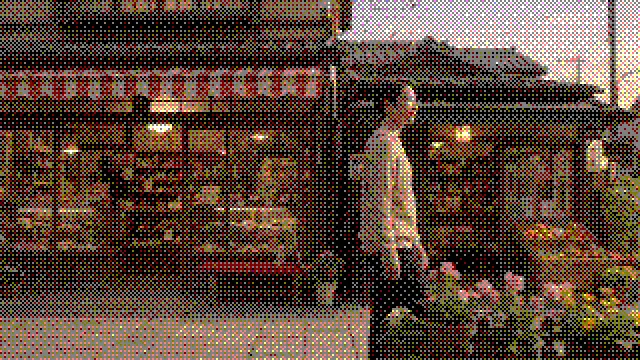</a> <a href="showcase/bayer8.webp">Play preview</a></td><td><a href="showcase/directional-h.webp">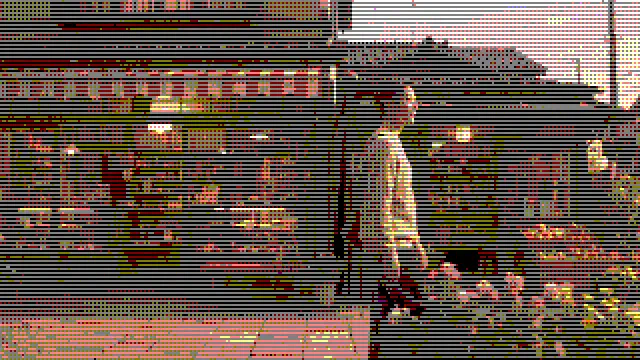</a> <a href="showcase/directional-h.webp">Play preview</a></td><td><a href="showcase/directional-v.webp">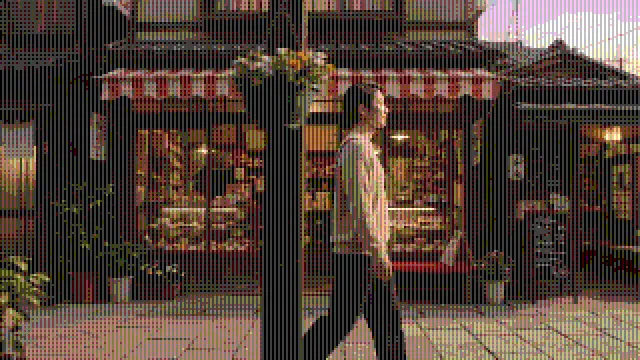</a> <a href="showcase/directional-v.webp">Play preview</a></td></tr>
<tr><th>Directional diagonal</th><th>Quasi-random</th><th>True blue noise</th></tr>
<tr><td><a href="showcase/directional-d.webp">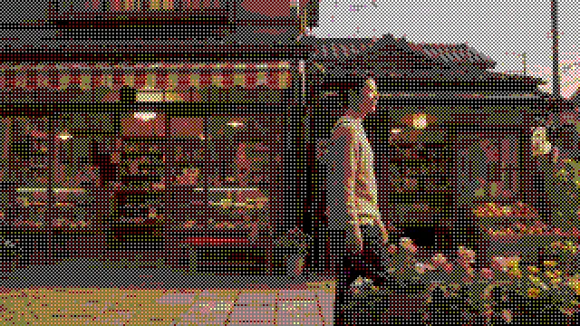</a> <a href="showcase/directional-d.webp">Play preview</a></td><td><a href="showcase/quasi-random.webp">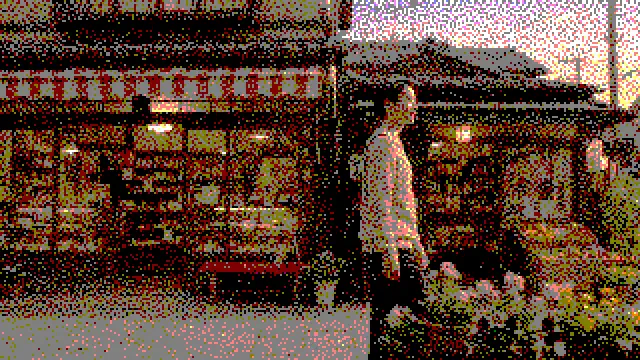</a> <a href="showcase/quasi-random.webp">Play preview</a></td><td><a href="showcase/blue-noise.webp">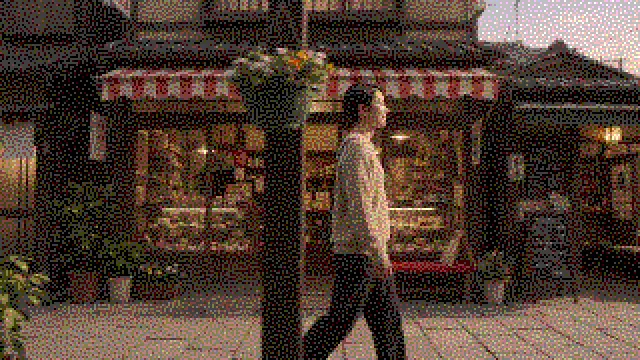</a> <a href="showcase/blue-noise.webp">Play preview</a></td></tr>
<tr><th>Floyd–Steinberg</th><th>Atkinson</th><th>Sierra Lite</th></tr>
<tr><td> <a href="showcase/floyd-steinberg.webp">Play preview</a></td><td><a href="showcase/atkinson.webp">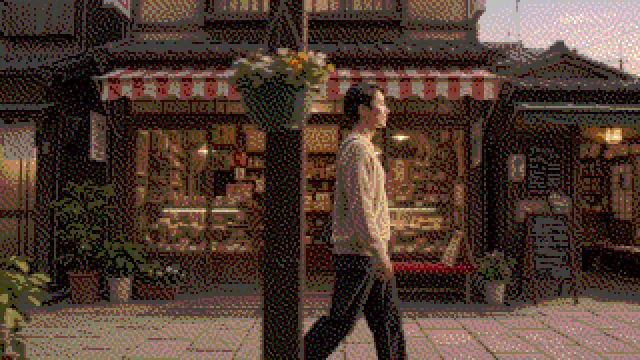</a> <a href="showcase/atkinson.webp">Play preview</a></td><td> <a href="showcase/sierra-lite.webp">Play preview</a></td></tr>
</table>

## Retro Codec

All eight real encoder/decoder paths use Historical profile and its default full-frame composition. Their output cadence and compression characteristics vary, so stills at equivalent playback times are not necessarily identical source frames.

<table>
<tr><th>H.263 Baseline</th><th>MPEG-4 Part 2</th><th>Cinepak</th></tr>
<tr><td><a href="showcase/codec-h263.webp">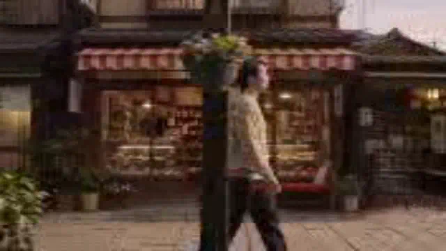</a> <a href="showcase/codec-h263.webp">Play preview</a></td><td> <a href="showcase/codec-mpeg4.webp">Play preview</a></td><td><a href="showcase/codec-cinepak.webp">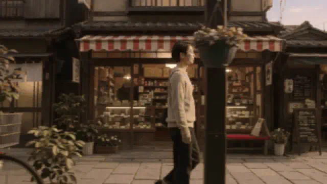</a> <a href="showcase/codec-cinepak.webp">Play preview</a></td></tr>
<tr><th>Sorenson Video 1</th><th>Microsoft Video 1</th><th>Sorenson Spark / FLV1</th></tr>
<tr><td> <a href="showcase/codec-svq1.webp">Play preview</a></td><td><a href="showcase/codec-msvideo1.webp">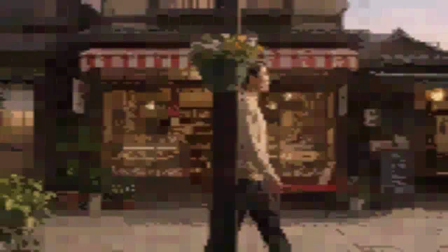</a> <a href="showcase/codec-msvideo1.webp">Play preview</a></td><td><a href="showcase/codec-flv1.webp">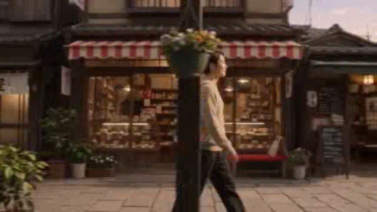</a> <a href="showcase/codec-flv1.webp">Play preview</a></td></tr>
<tr><th>MPEG-1</th><th>Motion JPEG</th></tr>
<tr><td><a href="showcase/codec-mpeg1.webp">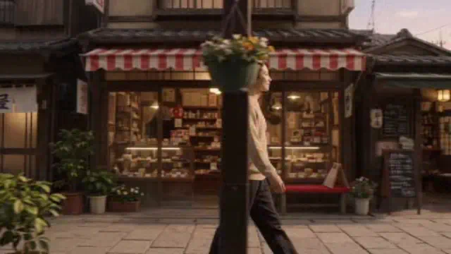</a> <a href="showcase/codec-mpeg1.webp">Play preview</a></td><td> <a href="showcase/codec-mjpeg.webp">Play preview</a></td></tr>
</table>

## VHS on-screen display

Default tape distortion with Always show status enabled; VCR uses PLAY, camcorder uses REC. The counters are simulated.

<table>
<tr><th>VCR / PLAY</th><th>Camcorder / REC</th></tr>
<tr><td><a href="showcase/vhs-vcr.webp">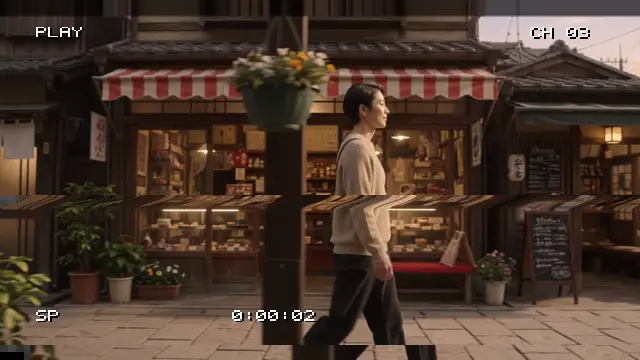</a> <a href="showcase/vhs-vcr.webp">Play preview</a></td><td><a href="showcase/vhs-camcorder.webp">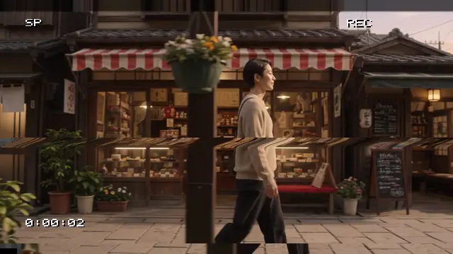</a> <a href="showcase/vhs-camcorder.webp">Play preview</a></td></tr>
</table>

## Capture notes

- Source: Gemini-generated Japanese shopping-street footage; original MP4 kept outside the repository.
- Source SHA-256: `ad50aead4ef8743c8aa3b03ac4fe283fa51f53aee1695a9c788696a780064a49`.
- Render source: 1280 × 720 at 24 fps, first three seconds scaled to 640 × 360 before plugin processing.
- Captured with the codec-enabled Linux plugin from source commit `59cc680` using a libobs raw-video callback.
- Exported as looping animated WebP at 12 fps, quality 72. Still thumbnails are lossless WebP copies of decoded preview frames at approximately 1.5 seconds.
- These are illustrative Linux render samples, not real-time performance or cross-platform qualification.
